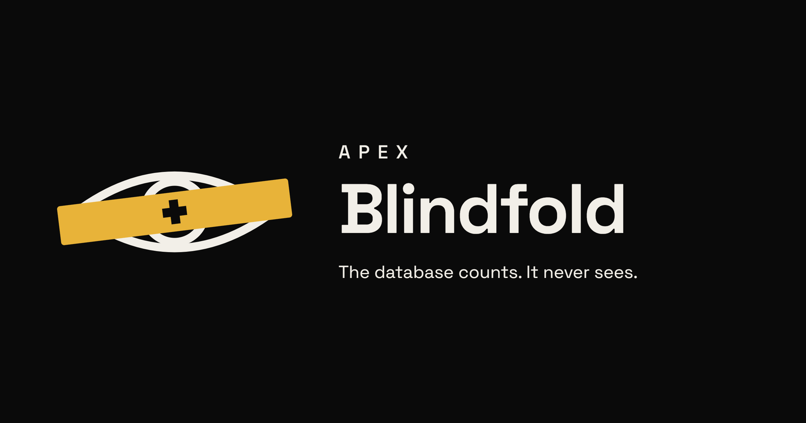
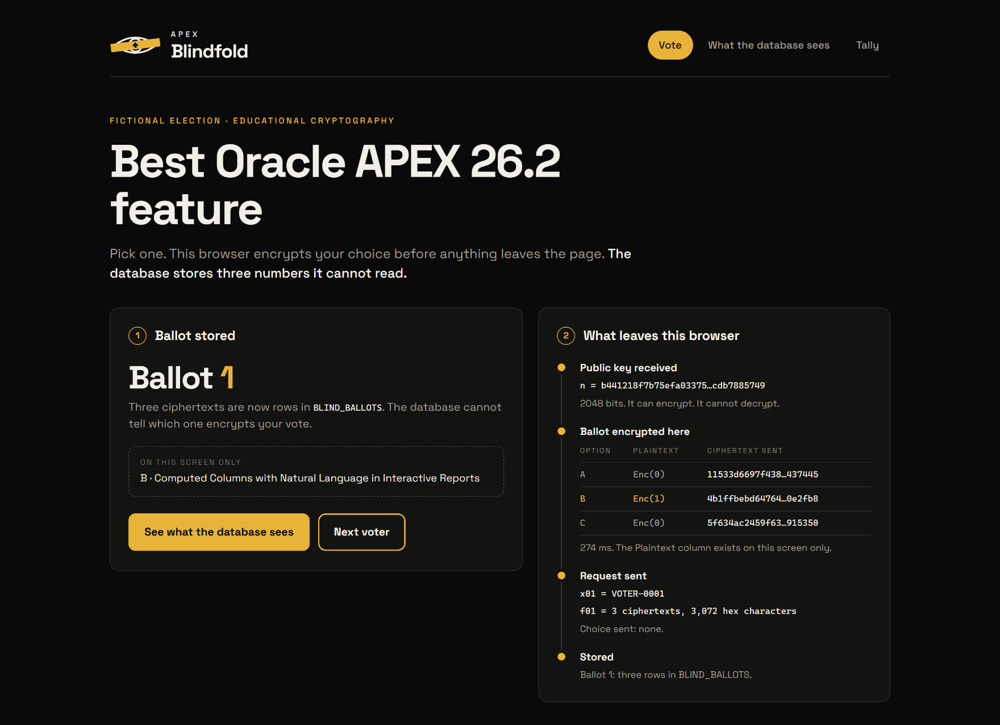
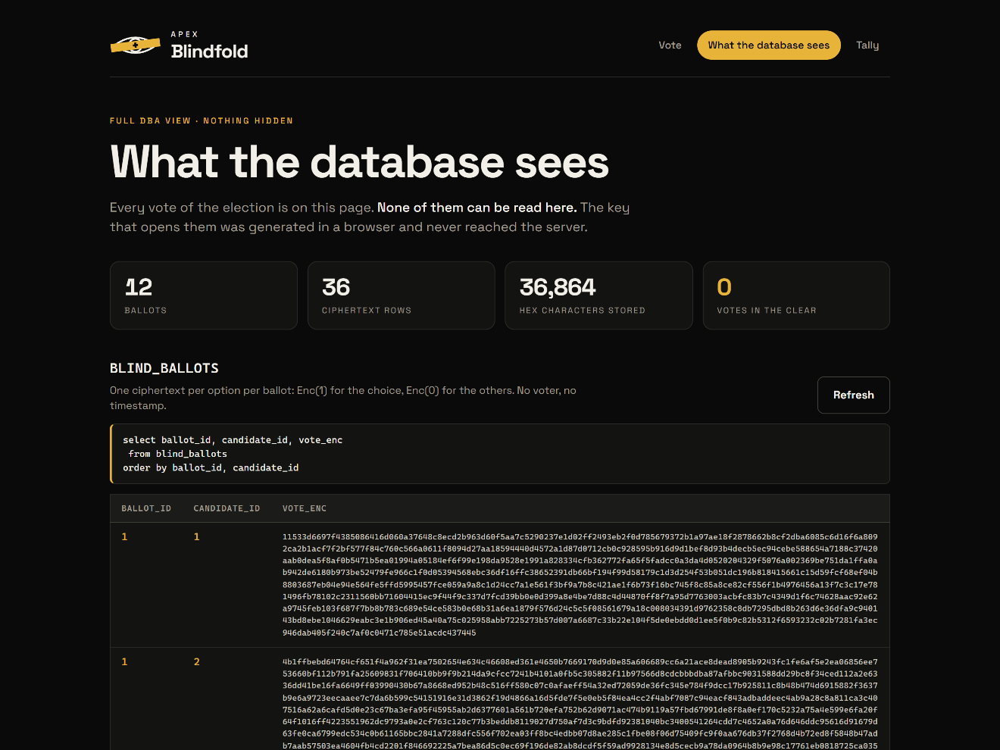
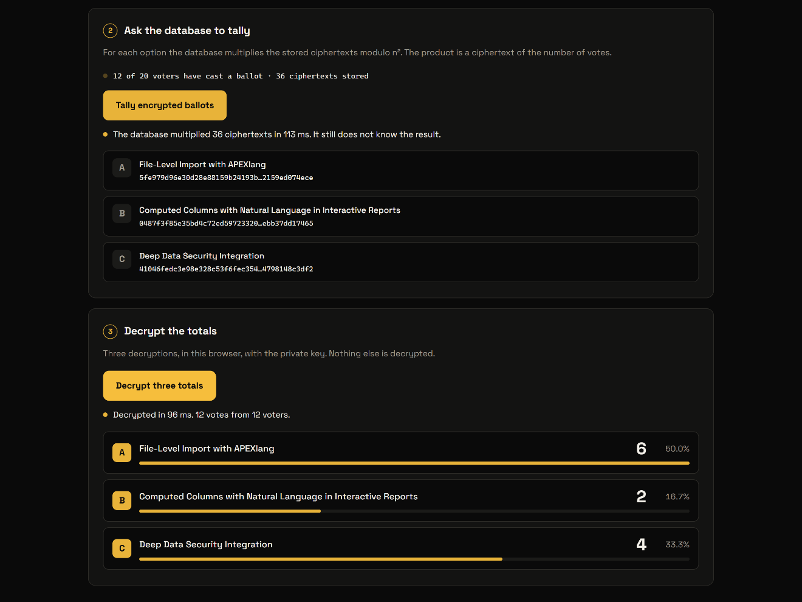
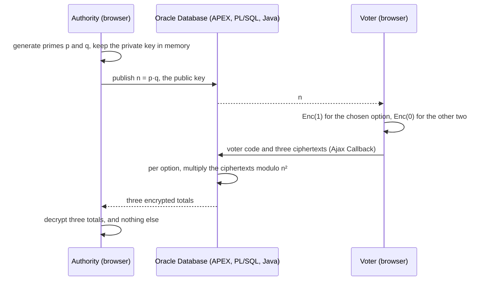
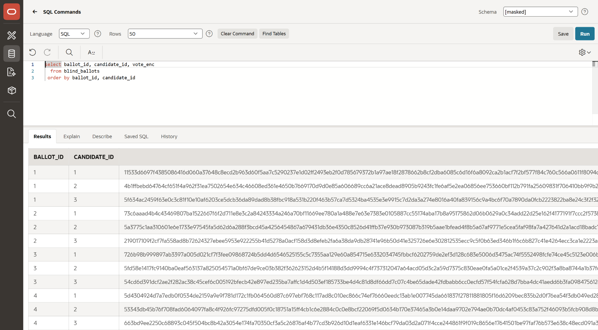
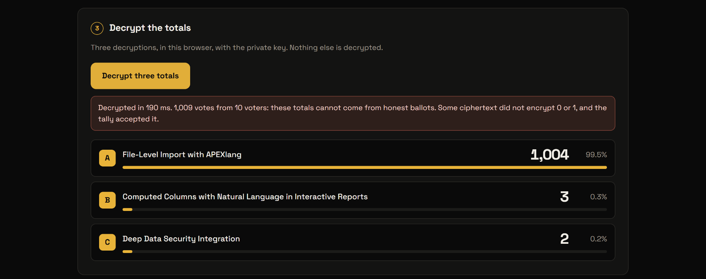
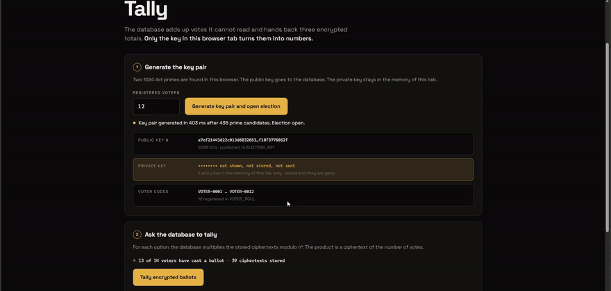
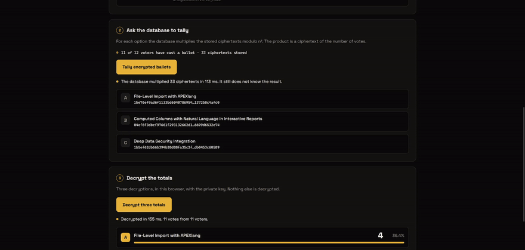

<h1 align="center">
  <picture>
    <source media="(prefers-color-scheme: light)" srcset="assets/lockup-light.png">
    
  </picture>
</h1>

<p align="center">
  <b>A tally the database cannot read: Paillier homomorphic voting in Oracle APEX.</b>
</p>

<p align="center">
  <a href="LICENSE"></a>
  
  
  
</p>

<p align="center">
  <a href="#the-question">The question</a> ·
  <a href="#how-it-works">How it works</a> ·
  <a href="#verdicts">Verdicts</a> ·
  <a href="#what-breaks-it">What breaks it</a> ·
  <a href="#live-session">Live session</a> ·
  <a href="#what-it-costs">What it costs</a> ·
  <a href="#reproduce-it">Reproduce it</a> ·
  <a href="#what-this-is-not">What this is NOT</a>
</p>

APEX Blindfold is a small research lab. An Oracle APEX application runs a fictional election,
"Best Oracle APEX 26.2 feature", with Paillier additively homomorphic encryption. Voters encrypt in
the browser, the database multiplies ciphertexts it cannot read, and only the holder of the private
key can decrypt the three totals. Six hypotheses put that idea under test, and each one closes with
evidence that one command regenerates.

> [!WARNING]
> **Educational cryptography. This is not a voting system.** The election is fictional and the code
> is unaudited. Read [What this is NOT](#what-this-is-not) before anything else.

## The question

**Can an Oracle APEX application tally an election where the database never sees a single vote?**

- **For reading, yes.** The database stored and counted every ballot. A test that knew the private
  key and every random number used looked for them in the tables, the APEX session state, the debug
  trace, the logs and the network traffic, and found neither a vote nor a piece of the key
  (H1, H2, H3).
- **For trusting the result, no.** A voter can cast one ballot worth a thousand votes, a DBA can
  move votes from one option to another, and whoever holds the key can open any single ballot
  (H4, H5). The lab demonstrates each of these, and describes the fixes without building them.

<p align="center">
  
</p>
<p align="center"><sub>The voter's browser encrypts the ballot and lists what it sent. The choice stays on the screen.</sub></p>

<table>
  <tr>
    <td width="50%"></td>
    <td width="50%"></td>
  </tr>
  <tr>
    <td align="center"><sub>The database stores one ciphertext per option per ballot, and nothing in the clear.</sub></td>
    <td align="center"><sub>It multiplies them into three encrypted totals. Only the authority's browser turns those into numbers.</sub></td>
  </tr>
</table>

<p align="center"><sub>Screenshots of the running application, cropped from <a href="evidence/app">evidence/app</a> by <code>scripts/readme-images.mjs</code>. Nothing is retouched.</sub></p>

## How it works



The cryptography is Paillier's scheme [[1]](#references) with `g = n + 1` [[2]](#references),
written from its definition with JavaScript `BigInt` and `crypto.getRandomValues`. The application
ships no cryptographic library.

```
keys      n = p·q      λ = lcm(p-1, q-1)      μ = λ⁻¹ mod n
encrypt   c = (1 + m·n) · rⁿ mod n²           r random, a fresh one for every ciphertext
add       c₁ · c₂ mod n²                      encrypts m₁ + m₂
scale     cᵏ mod n²                           encrypts k·m
decrypt   m = L(c^λ mod n²) · μ mod n         L(x) = (x - 1) / n
```

Three pieces of code carry the whole idea. The browser encrypts
([`paillier.js`](app/apexlang/shared-components/static-files/blindfold/paillier.js)):

```js
export function encryptWithRandomizer(publicKey, message, randomizer) {
  const { n, nSquared } = publicKey;
  const m = BigInt(message);
  if (m < 0n || m >= n) throw new RangeError('message must be in [0, n)');
  return (((1n + m * n) % nSquared) * randomizer) % nSquared;
}
```

The browser sends a voter code and three ciphertexts, and no page item
([`vote.js`](app/apexlang/shared-components/static-files/blindfold/vote.js)):

```js
answer = await callback('CAST_BALLOT', { x01: voter, f01: ballot });
```

The database multiplies what it cannot read
([`02_blind_tally_java.sql`](db/02_blind_tally_java.sql)):

```java
// Homomorphic addition: Enc(a) * Enc(b) mod n^2 = Enc(a + b).
totals.put(candidate, totals.get(candidate).multiply(ciphertext).mod(nSquared));
```

| Where | What runs there | What it holds |
|---|---|---|
| Authority's browser | key generation (Miller-Rabin primes of 1024 bits), decryption of the three totals | the private key, in memory only |
| Voter's browser | encryption of the ballot | the choice, until the tab moves on |
| Database | `BLIND_BALLOTS` (one ciphertext per option per ballot), `VOTER_ROLL` (turnout), `ELECTION_KEY` (n), and a Java stored procedure that multiplies ciphertexts | ciphertexts and the public key |

The application has three public pages: **Vote** for the voter, **What the database sees**, which
shows the two tables as a `SELECT` returns them, and **Tally** for the election authority.

The lab design asked for the tally in a JavaScript MLE module. The database the lab ran on answered
`MLE is not available on this platform`, which agrees with the platforms Oracle lists for MLE
[[3]](#references), so the tally is a Java stored procedure that uses `java.math.BigInteger`. The
probe and its output are in [`evidence/00-environment`](evidence/00-environment).

## Verdicts

Each hypothesis closes as CONFIRMED, REFUTED or PARTIAL. For H4 and H5, CONFIRMED means that the
attack works.

<!-- verdicts:start -->
| # | Hypothesis | Verdict | Observed | Evidence |
|---|---|---|---|---|
| H1 | Correctness | **CONFIRMED** | The decrypted tally equals the true tally in 100/100 randomized elections (10 to 5000 voters, 82874 ballots), and JavaScript, Java and Python agree on every value compared. | [elections.txt](evidence/h1-correctness/elections.txt) |
| H2 | Blindness | **CONFIRMED** | Knowing the private key and the randomizer of all 27 ciphertexts, the test found none of them, whole or in part, in 21 sources: 231 HTTP requests and their responses, 4 tables, APEX session state (0 page items; 2 report paging positions), 4423 LEVEL9 debug messages, the activity and access logs, 172 SQL statements, captured binds, audit trail, alert log, and the storage of both tabs. Ballot requests differ only in the voter code and three ciphertexts. ORDS log files were not read. | [scan-summary.txt](evidence/h2-blindness/scan-summary.txt) |
| H3 | Indistinguishability | **CONFIRMED** | All 6000 stored ciphertexts are distinct, and none of 13 distinguishers separates Enc(0) from Enc(1) on 4000 labelled ciphertexts (classifier accuracy 51.4%). Indistinguishability itself rests on the DCR assumption, which a test cannot prove. | [distinguishers.txt](evidence/h3-indistinguishability/distinguishers.txt) |
| H4 | Ballot stuffing | **CONFIRMED** | The tally accepted a ballot encrypting 1000 (A=4 B=3 C=2 became A=1004 B=3 C=2). A balanced ballot of [3, -2, 0] changed the result (A=7 B=1 C=2) while the totals still added up to the turnout. | [stuffing.txt](evidence/h4-ballot-stuffing/stuffing.txt) |
| H5 | Other limits | **CONFIRMED** | All three limits hold: a DBA with the public key moved 5 votes with two UPDATEs and the totals still matched the turnout; the key holder read 24/24 individual ballots; ordering by voted_at and ballot_id re-linked 24/24 voters arriving one at a time (59/200 exactly, 199/200 within 7 positions, when 8 sessions vote at once). | [a-dba-adds-votes.txt](evidence/h5-limits/a-dba-adds-votes.txt) |
| H6 | Cost | **CONFIRMED** | Measured: casting a ballot takes a median 289 ms in the browser; tallying 10000 voters takes 4.9 s against 1.074 ms for a plaintext COUNT (4584x); a ballot stores 3087 bytes against 5. | [summary.txt](evidence/h6-cost/summary.txt) |

One run from a clean schema: 2026-11-23, full mode, seed 20261123, 19 minutes.
Each row is the sentence the test itself wrote into its `result.json`. The same table, with the
time of every step, is in [`evidence/summary.md`](evidence/summary.md).
<!-- verdicts:end -->

## What the DBA sees

The page *What the database sees* is the application describing itself. This is the same question
asked outside the application, in APEX SQL Workshop:

<p align="center">
  
</p>
<p align="center"><sub>Cropped from <a href="evidence/h2-blindness/dba-select.png">evidence/h2-blindness/dba-select.png</a>. Schema, workspace and user names are masked.</sub></p>

A `SELECT` that shows nothing readable proves little, so H2 goes further. The test records the
random bytes that both browsers draw, which lets it recompute the private key and the random number
inside every ciphertext. It then searches for those numbers, whole and in fragments, in everything
the server received or kept: both sides of every HTTP request, the tables, the source code of the
schema, the APEX session state, a LEVEL9 debug trace, the APEX logs, the SQL area with its captured
binds, the audit trail and the alert log. It also searches the storage and the HTML of both browser
tabs.

Two controls show that the search can find something. It plants the secrets in text and finds them,
and it sends a decoy secret through the real application and finds it in the ballot table and in the
network record. The same control shows that the session state, the debug trace, the activity log and
the SQL area recorded no request parameters at all in that run, so their silence says little by
itself: the network record is the complete one. See
[`controls.txt`](evidence/h2-blindness/controls.txt) and
[`scan-summary.txt`](evidence/h2-blindness/scan-summary.txt).

Not inspected: the ORDS log files, redo, undo and flashback data, the memory of the database and
ORDS processes, and timing or traffic analysis.

## What breaks it

The blindfold hides the votes. It does not protect the count. Every row below was carried out
against the running application.

<!-- attacks:start -->
| Attack | Who can do it | What happened in the lab | Does the application notice? | Evidence |
|---|---|---|---|---|
| **Stuff a ballot.** Encrypt `[1000, 0, 0]` where an honest ballot encrypts a single 1. | A registered voter, from the browser console | A=4 B=3 C=2 became **A=1004 B=3 C=2** | Only in the sum: 1,009 votes from 10 voters. Nothing says which ballot. | [stuffing.txt](evidence/h4-ballot-stuffing/stuffing.txt) |
| **Stuff it quietly.** Encrypt `[3, -2, 0]`, which still adds up to one vote. | A registered voter, from the browser console | A=4 B=3 C=2 became **A=7 B=1 C=2** | No. 10 votes from 10 voters. | [stuffing.txt](evidence/h4-ballot-stuffing/stuffing.txt) |
| **Move votes.** Multiply one stored ciphertext by `Enc(5)` and another by `Enc(-5)`. | A DBA with the public key and two `UPDATE` statements | A=6 B=7 C=7 became **A=1 B=12 C=7** | No. 20 votes from 20 voters, and the same number of rows. | [a-dba-adds-votes.txt](evidence/h5-limits/a-dba-adds-votes.txt) |
| **Open single ballots.** Decrypt rows of the table, not the three totals. | Whoever holds the private key | **24 of 24** ballots read | No. | [b-key-holder-reads-ballots.txt](evidence/h5-limits/b-key-holder-reads-ballots.txt) |
| **Re-link voters to ballots.** Sort `VOTER_ROLL` by `voted_at` and the ballots by `ballot_id`. | Anyone who reads both tables | **24 of 24** voters paired with their own ballot when they vote one at a time. With 8 sessions voting at once: 59 of 200 exactly, 199 of 200 within 8 positions. | No. | [c-relinking.txt](evidence/h5-limits/c-relinking.txt) |
| **Swap the public key** while voters are voting. An extra, not one of the hypotheses. | A DBA who can write to the tables | **4 of 4** ballots cast under the swapped key were read, and the tally the authority decrypted was still correct | No. | [extra-key-substitution.txt](evidence/h5-limits/extra-key-substitution.txt) |
| **Lose the key.** Reload the browser tab that holds the private key. An extra, found in the live session. | The authority, by accident | A=1 B=2 C=0 was decrypted while the tab was alive. After a reload the encrypted totals could still be fetched and **could not be decrypted** | It asks first, through the browser, whose question mentions unsaved information and no key. | [extra-key-loss.txt](evidence/h5-limits/extra-key-loss.txt) |
<!-- attacks:end -->

<p align="center">
  
</p>
<p align="center"><sub>One ballot, a thousand votes. The page can tell that something is wrong, not which ballot did it. Cropped from <a href="evidence/h4-ballot-stuffing/01-stuffed-tally.png">evidence/h4-ballot-stuffing</a>.</sub></p>

What a real system adds. All of it is described here, and none of it is built:

| Layer | Status in this lab | What it is |
|---|---|---|
| 1. Blind tally | **built and measured** | the application in this repository |
| 2. Ballot validity | attack shown, fix described only | Every ballot carries a zero-knowledge proof that each ciphertext encrypts 0 or 1 and that the three plaintexts add up to 1. The server, and anyone else, checks the proof without learning the vote, and rejects a ballot whose proof fails [[2]](#references). |
| 3. Threshold decryption | described only | The private key is split among several trustees, so that no single party can open a ballot [[2]](#references). |

The remaining attacks have no layer in this list. Stored ciphertexts carry no signature and the
table keeps no history, the voter receives the public key from the server and has no copy to compare
it with, and the order of arrival survives in more places than the two columns the test used. The
lab shows these and stops there.

## Live session

Everything above was run by the hands that built the lab. On 23 November 2026 the lab was put in
front of its author instead. Geraldo generated the keys and voted in his own browsers. The AI
assistant that wrote the code under his supervision played the DBA: full DBA access, no view of his
screen.

<p align="center">
  
</p>
<p align="center"><sub>His recording of the moment the stuffed election is counted, cut to the page and reduced. The full segment is <a href="evidence/live-session/video/07-election-b-stuffed-tally.mp4">07-election-b-stuffed-tally.mp4</a>.</sub></p>

<!-- live:start -->
| What was tried | What happened | Evidence |
|---|---|---|
| **The DBA guesses every vote**, with full DBA access and no view of the voter's screen. | 2 rounds, 23 ballots. The guesses were committed, and their hash pushed to this repository, before each reveal. **10 hits**, where blind guessing gives 7.7; 10 or more come up by luck in 20.6% of attempts. Guesses that came from something the DBA had read: 0. | [challenge-summary.txt](evidence/live-session/challenge-summary.txt) |
| **The authority counts the honest election.** | 11 ballots, decrypted in his browser as **A=4 B=3 C=4**: the counts of his 11 receipts. | [screenshot](evidence/live-session/screenshots/03-honest-tally-decrypted.png) |
| **The voter looks for his own vote.** He runs the `SELECT` statements himself, as `SYSTEM`, knowing how he voted. | Asked whether he could point to his own vote in those rows, he answered: "Honest answer: I would not know my vote." | [his five queries](evidence/live-session/screenshots/04-dba-select-1-ballots.png) |
| **The voter stuffs the ballot box**, with one snippet in the browser console. | The database accepted a ballot worth 1,000 votes. His 12 honest ballots, A=6 B=3 C=3, were tallied as **A=1006 B=3 C=3**. A ballot of `[3, -2, 0]` then made it A=1009 B=1 C=3. | [the console](evidence/live-session/video/06-election-b-ballot-of-a-thousand.mp4), [the tally](evidence/live-session/video/07-election-b-stuffed-tally.mp4) |
| **The authority keeps the key**, which lives in the memory of one browser tab. | He lost it twice: once before any ballot, once after the honest tally above. From then on neither election could be counted. The second time is on his recording: the browser asked whether to leave the page, and the answer was yes. | [the recording](evidence/live-session/video/04-leave-page-question.mp4) |
<!-- live:end -->

The last row was not in the script, and it is the result nobody had planned for. The page did ask
before letting go of the key. The browser words that question itself, and its text mentions unsaved
information, not a key. Since then the links of the Tally page open in a new tab once it holds a key,
and the automated run reproduces the loss as part of H5.

<p align="center">
  
</p>
<p align="center"><sub>The moment the second key is lost. The dialog is the browser's own and reads: "This page asks you to confirm that you want to leave. Information you entered may not be saved." Its heading, which names the host, is painted over. The full segment is <a href="evidence/live-session/video/04-leave-page-question.mp4">04-leave-page-question.mp4</a>.</sub></p>

Screenshots, eight segments of his screen recordings and the state of the database after every step
are in [`evidence/live-session`](evidence/live-session/README.md), together with everything that went
wrong. GitHub does not play an MP4 in the page: open a segment and choose *View raw* to download it.

## What it costs

<!-- cost:start -->
| In the browser | Where | Median | Fastest and slowest | Samples |
|---|---|---:|---:|---:|
| Generate the 2048-bit key pair | authority's browser | **176 ms** | 80.8 ms to 349 ms | 20 |
| Encrypt one ballot (three ciphertexts) | voter's browser | **224 ms** | 206 ms to 244 ms | 30 |
| Cast one ballot, from the click to the receipt | voter's browser and database | **289 ms** | 279 ms to 410 ms | 30 |
| Decrypt one total | authority's browser | **31.5 ms** | 31.2 ms to 31.8 ms | 30 |

| Voters | Blind tally | Plaintext `COUNT` | Ratio | Stored per ballot | Plaintext per ballot |
|---:|---:|---:|---:|---:|---:|
| 100 | **61.3 ms** | 0.504 ms | 122x | 3,084 bytes | 4.0 bytes |
| 1,000 | **504 ms** | 0.49 ms | 1,028x | 3,087 bytes | 4.9 bytes |
| 10,000 | **4,924 ms** | 1.074 ms | 4,584x | 3,087 bytes | 5.0 bytes |

- The tally time is the median of repeated runs of one statement, seen from the client. The first tally of a new database session, which starts its Java virtual machine, took 133 ms, 607 ms and 5,301 ms.
- One ballot travels as a request body of 3,284 bytes. Storage is the size of the column values, without block or index overhead.
- Browser, ORDS and database ran on the same machine: Intel Core i7-9700KF CPU @ 3.60GHz, 8 logical cores, msedge 158.0.4370.33 (headless).
- Raw measurements: [timings.json](evidence/h6-cost/timings.json). Summary: [summary.txt](evidence/h6-cost/summary.txt).
<!-- cost:end -->

## Reproduce it

The lab was built and run on the versions below, with SQLcl 26.3 to import the APEXlang source of
the application. Other versions were not tested.

<!-- environment:start -->
| Component | Version the lab ran on |
|---|---|
| Database | Oracle AI Database 26ai Free Release 23.26.3.0.0, on Microsoft Windows x86 64-bit |
| Tally engine | Java stored procedure, database JVM 11.0.32 |
| Oracle APEX | 26.2.0 |
| ORDS | 26.3.0 |
| Node.js | 22.16.0 |
| Python (cross-check only) | 3.13.15 |
| Browser | msedge 158.0.4370.33 (headless), driven by Playwright |
<!-- environment:end -->

One-time setup:

```sh
git clone https://github.com/B2DEV-TECH/apex-blindfold.git
cd apex-blindfold
npm ci
mkdir .local
cp scripts/db.example.json .local/db.json
```

Edit `.local/db.json`: the address of your database and three passwords of your choice. The folder
`.local` is ignored by git. Then create the lab schema, the DBA account that the audits use and the
APEX workspace, either with `node scripts/bootstrap-local.mjs` on the database host (it connects as
SYSDBA through the operating system) or by running
[`db/admin/create_schema.sql`](db/admin/create_schema.sql) as a DBA. The browser tests use an
installed Microsoft Edge or Google Chrome, or the Chromium that `npx playwright install chromium`
downloads.

After that, one command installs everything into a clean schema, runs the unit tests and the six
hypotheses, takes the screenshots and writes the verdicts to `evidence/summary.md`:

```sh
npm run lab
```

| Command | What it does |
|---|---|
| `npm run lab` | the whole lab from a clean schema; the time it took here is under the verdict table |
| `npm run lab:quick` | the same steps with smaller samples, in a few minutes |
| `node tests/run-all.mjs --only h4,h5` | some steps only, without reinstalling |
| `node tests/run-all.mjs --seed 7` | another replayable set of random elections |
| `npm run readme:check` | fails if a table of this README disagrees with `/evidence` |
| `npm run scan` | looks for passwords, host names, accounts and addresses in every file git would publish |

A hypothesis that comes out REFUTED is a result, not a failure of the run. The run fails only when a
step crashes or leaves no result.

### Run it against a person

The automated tests know every secret, which is what lets them search for one. The opposite
experiment needs two people: one votes, the other has full DBA access and tries to tell how.
[`tests/live/RUNBOOK.md`](tests/live/RUNBOOK.md) is the script of that session. The DBA writes the
guesses to a file and publishes its hash before the voter reveals anything. The script was corrected
after its first use, which is the [live session](#live-session) above.

## What this is NOT

- **Not a real voting system.** It has no voter authentication worth the name, no ballot secrecy
  against the people who run it, no receipt, no audit and no legal standing. Do not use it to decide
  anything.
- **Not fully homomorphic encryption.** Paillier adds plaintexts and multiplies them by constants.
  It cannot evaluate arbitrary functions on encrypted data.
- **Unaudited, educational cryptography.** The code follows the textbook definition so that it can be
  read. Nobody has reviewed it for side channels, weak parameters or implementation mistakes.
- **No integrity guarantees.** Ballots are not proven valid and stored ciphertexts are not protected:
  see H4 and H5. The tally is only as honest as every voter and every administrator.
- **The server ships the JavaScript.** The browser encrypts with code the server sent. A server that
  wants the votes or the private key can send code that leaks them, and the lab does nothing
  about it.
- **Not an Oracle feature, and not endorsed by Oracle.** It is an independent experiment that uses
  Oracle APEX and Oracle AI Database.
- **No evaluation of any real election system.** The election is fictional, and nothing here
  describes, tests or judges a system used in a real election.

## Article

[A Tally the Database Cannot Read: Homomorphic Voting in Oracle APEX](https://b2dev.tech/blog/apex-blindfold-a-tally-the-database-cannot-read),
published on b2dev.tech on 23 November 2026, is the write-up of this lab.

## Repository layout

| Path | Content |
|---|---|
| [`app`](app) | the APEX application: APEXlang source in `app/apexlang`, SQL export in `app/f2620.sql` |
| [`db`](db) | tables, the Java tally, the PL/SQL packages, install and uninstall scripts |
| [`tests`](tests) | unit tests, one script per hypothesis, the runner, the tools of the live session |
| [`evidence`](evidence) | the output of one full run, in one folder per hypothesis, and the record of the live session in [`evidence/live-session`](evidence/live-session/README.md) |
| [`scripts`](scripts) | installation, the scan that runs before a push, the generators of this README |
| [`assets`](assets) | logo, and the README images and animation made from the evidence |

## References

1. Pascal Paillier, "Public-Key Cryptosystems Based on Composite Degree Residuosity Classes",
   EUROCRYPT '99, LNCS 1592, pp. 223-238. <https://doi.org/10.1007/3-540-48910-X_16>.
   The scheme and its additive homomorphism.
2. Ivan Damgård and Mads Jurik, "A Generalisation, a Simplification and some Applications of
   Paillier's Probabilistic Public-Key System", BRICS Report Series RS-00-45.
   <https://www.brics.dk/RS/00/45/>. The choice `g = n + 1`, a threshold variant of the scheme, and
   proofs that a ciphertext encrypts one of a given set of values, applied to voting.
3. Oracle, "Overview of Multilingual Engine for JavaScript", Oracle Database JavaScript Developer's
   Guide.
   <https://docs.oracle.com/en/database/oracle/oracle-database/26/mlejs/overview-multilingual-engine-javascript.html>.
   The platforms on which MLE is available.

## About

Geraldo Viana Jr. led the experiment and made the design decisions. An AI assistant wrote the code
and ran the automated tests under his supervision.

## License

[Apache License 2.0](LICENSE). The bundled Space Grotesk typeface is under the SIL Open Font
License 1.1; see [NOTICE](NOTICE).
